<p align="center">
  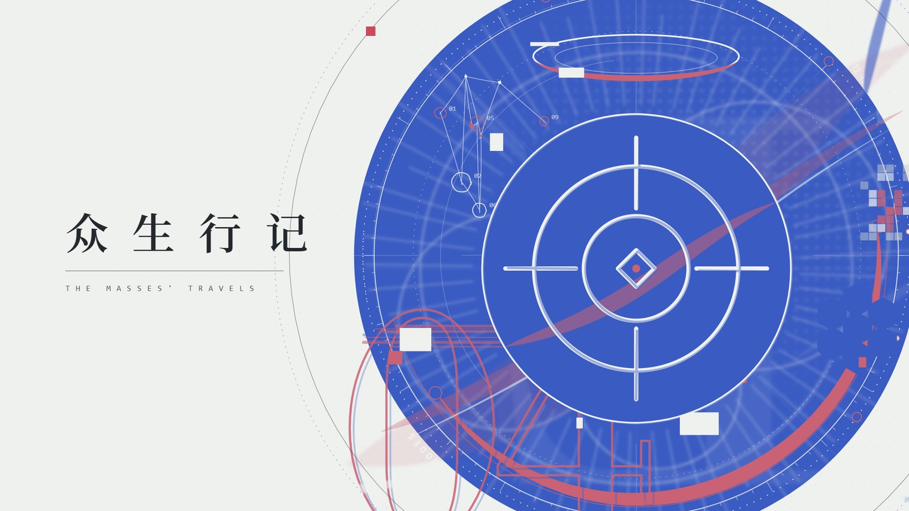
</p>

<h1 align="center">众生行记 · 平面设计交互图录</h1>

<p align="center">
  <b>一张立绘都没用，把「众生行记」做成了一本能上手玩的平面设计网页。</b><br>
  <sub>TypeScript · Three.js · Vite ｜ 所有图版实时绘制 ｜ 双击即开，离线可用</sub>
</p>

<p align="center">
  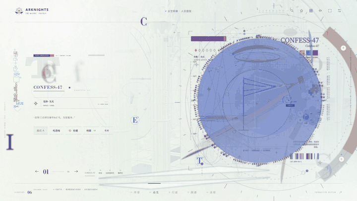
</p>

《明日方舟》六周年 PV 和「众生行记」活动界面里，最迷人的是那些**会呼吸的平面构成**：抖动的圆环、两端渐细的笔触、套印错开半毫米的数字、飞散的羽兽、一枚钴蓝圆盘压在半调网点上。

这个项目把这些东西全部拆开、重新画出来，再拼回一个可以拖、可以点、可以拆的网页：

- **零立绘。** 主视觉、干员档案与图谱采用实时生成的图形；行迹地图组合游戏地图素材、SVG 标记与 Canvas 动画。
- **线条是“画”出来的。** 圆环会越过起点再收笔，标线微微拱起又冲出端点，每条线描两遍、故意对不准。
- **图层越靠前，线越粗。** 远景细如发丝，近景像马克笔。
- **到处藏着东西。** 连对三个点，图形会自己闭合；按对光的方向，圣堂会亮起一道光。

---

## 🚪 三秒打开

双击 **`双击打开.html`**，用 Edge 或 Chrome 打开就行。

不用 Node.js，不用联网，不用开终端。这一个文件约 4.5 MiB，里面是全部交互代码、图形和活动 BGM。

> 声音默认关闭，点右上角的声音按钮开启。收藏和设置保存在当前浏览器；如果浏览器限制本地文件存储，仍然可以浏览，只是收藏可能不会跨次保留。

---

## 🗺️ 六个房间

### 序章 · 主视觉

<table>
<tr>
<td width="50%">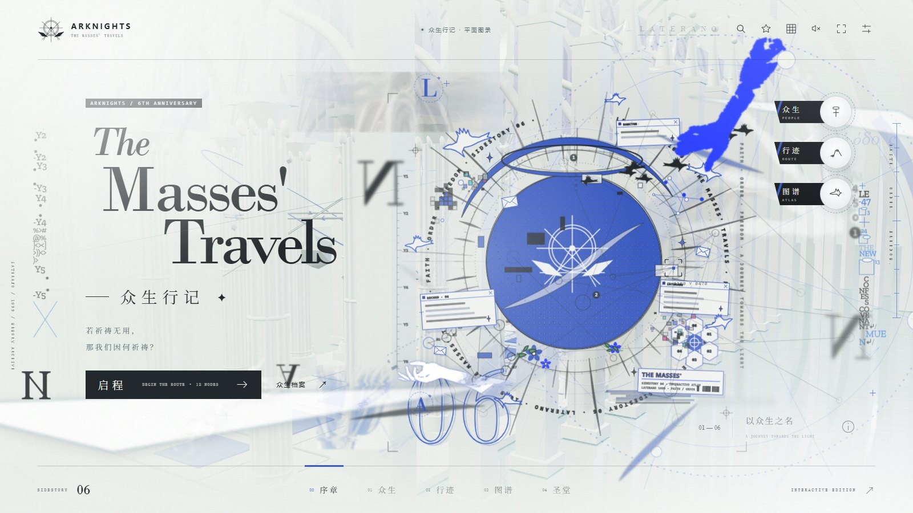</td>
<td width="50%">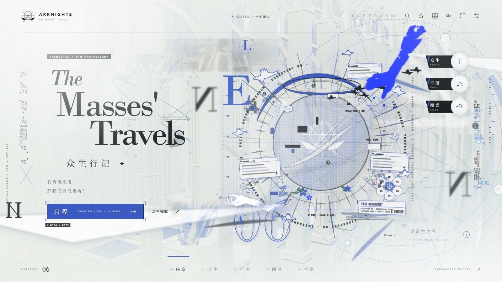</td>
</tr>
<tr>
<td align="center"><sub>平时：钴蓝圆盘、环形铭文、飞离的羽兽、外框数字 06</sub></td>
<td align="center"><sub>悬停入口：圆盘褪成线框，射线开始流动，尺寸标注浮现</sub></td>
</tr>
</table>

首页是一张拼贴海报，各层随指针按景深视差：

- 中心是钴蓝圆盘、半调网点、光环、放射线和光刃碎片；
- 后面压着浏览器窗口般的小界面框（RECORD·06 / LATERANO / SANCTUM）、车票、信封和像素块；
- 前面飞着鸽子、开着小花；
- 右上角一只**纯色钴蓝的手**，配一层游戏原版的线稿手。

### 众生 · 人员图版

<table>
<tr>
<td width="33%">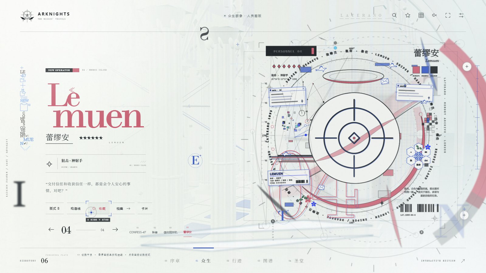</td>
<td width="33%">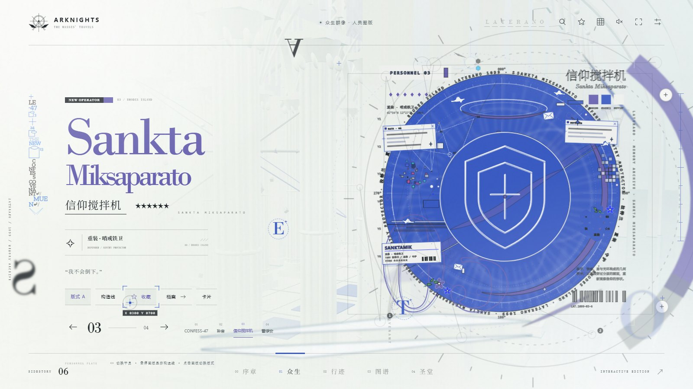</td>
<td width="33%">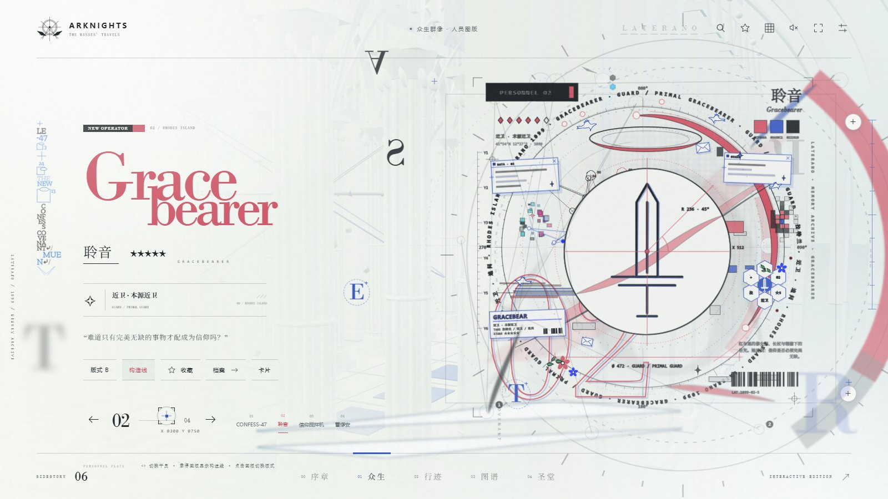</td>
</tr>
<tr>
<td align="center"><sub>蕾缪安 · 版式 A</sub></td>
<td align="center"><sub>信仰搅拌机 · 点一下图版，切到钴蓝版式 B</sub></td>
<td align="center"><sub>聆音 · 「构造线」显示尺寸与角度</sub></td>
</tr>
</table>

四位干员：CONFESS-47、聆音、信仰搅拌机、蕾缪安。每人一张**人员图版**，由十几层图层叠成：

- **远景**（模糊）：半调网点、镜像首字母、大圆、放射线；
- **中景**：外框编号的套印错位、星座节点、六边形组、马赛克、扫描故障条；
- **拼贴层**：界面框、车票、信封、鸽子、花枝；
- **近景**：职业线形图标（先锋旗 / 近卫剑 / 重装盾 / 狙击准星）、按星级长度的色弧、色票与条码。

切换干员时，各层按景深依次拼入，旧图版淡出，新图版淡入。名字由散落的字母汇聚而成。档案、收藏、导出、生成卡片都在这里。

### 行迹 · 一张能拖的地图

<table>
<tr>
<td width="50%">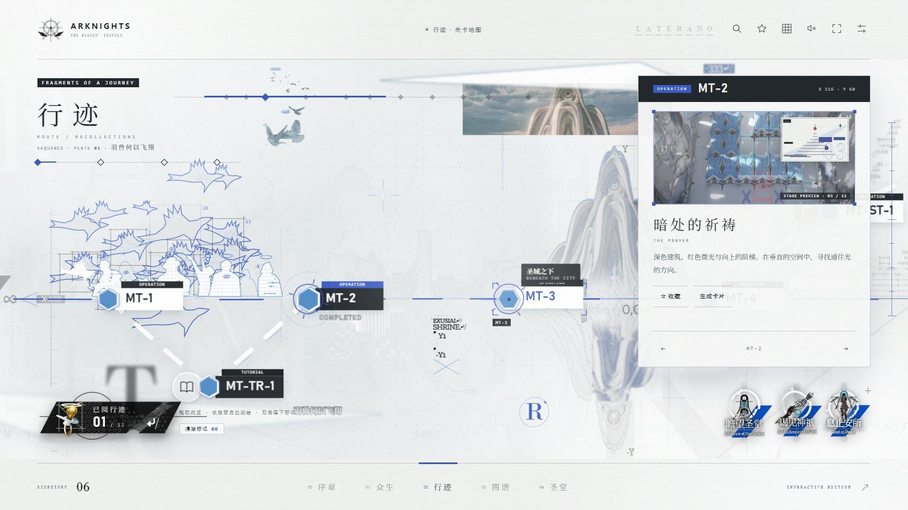</td>
<td width="50%">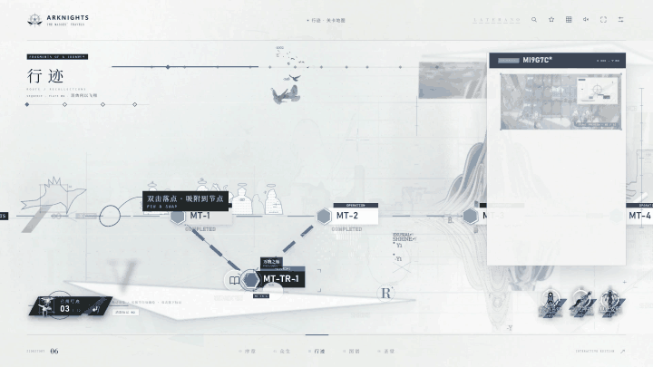</td>
</tr>
<tr>
<td align="center"><sub>悬停：旋转锁定圈出现，相连支线被点亮</sub></td>
<td align="center"><sub>双击 MT-1 → MT-TR-1 → MT-2：三角形自己闭合，放出「启程」图形</sub></td>
</tr>
</table>

活动原地图长卷和图集碎片被拆成五层视差：

- 碎片靠近画面中心时会变清晰、上色；
- **拖得越快**，画面越模糊、越倾斜，速度线和像素故障也越强；
- 拖动同时驱动背后的序列：羽兽 → 草木 → 光环 → 双手，往回拖就倒放。

| 手势 | 会发生什么 |
| --- | --- |
| 悬停节点 | 手绘六边形外转出锁定圈，相连的支线亮起 |
| **长按**空白处 | 发出测绘脉冲，附近节点报出距离，附近碎片短暂清晰 |
| **双击** | 落下标记，按顺序以虚线相连；绕回任意一个早先的标记，就画出闭合图形并标出面积 |
| 点击节点 | 详情面板：干员的人员图版，或关卡预览图加一张按记录绘制的小图版（羽翼 / 阶梯 / 街道透视 / 尖拱 / 柱廊 / 倒影） |

### 图谱 · 三张会回应你的图纸

<table>
<tr>
<td width="50%">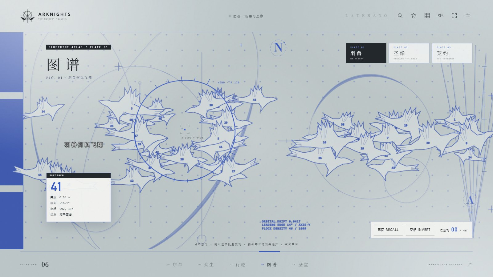</td>
<td width="50%">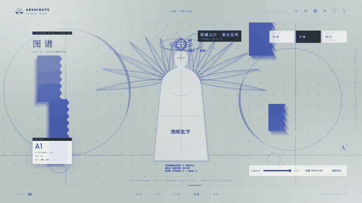</td>
</tr>
<tr>
<td align="center"><sub>FIG. 01 羽兽：指针带着一枚手绘视场圈，鸟群被风推开</sub></td>
<td align="center"><sub>FIG. 02 圣像：在光环与两侧衣摆落下构造圆，三角闭合，羽翼展开</sub></td>
</tr>
</table>

- **FIG. 01 羽兽**：悬停读编号；点击或框选把鸟放飞；可以召回，也可以反相。
- **FIG. 02 圣像**：滑杆展开羽翼。点空白处落下构造圆 A1、A2……，以手绘引线相连，「测量」显示间距。构造圆靠近隐藏点位时会吸附过去。
- **FIG. 03 契约**：指针牵引右手，指尖越近越蓝，两手相触时闪光，拼出 COVENANT。

### 圣堂 · 拆得开的建筑

<table>
<tr>
<td width="50%">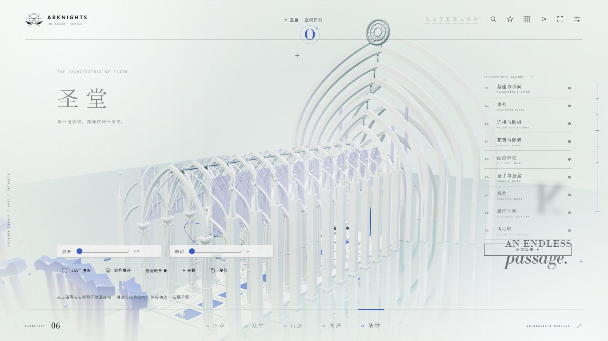</td>
<td width="50%">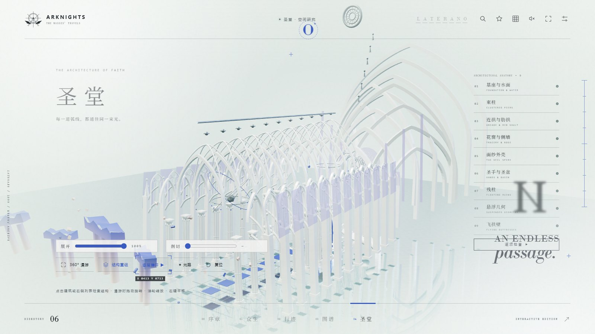</td>
</tr>
<tr>
<td align="center"><sub>程序建模的圣堂，九组结构</sub></td>
<td align="center"><sub>「结构展开」：每组沿自己的方向退开</sub></td>
</tr>
<tr>
<td width="50%">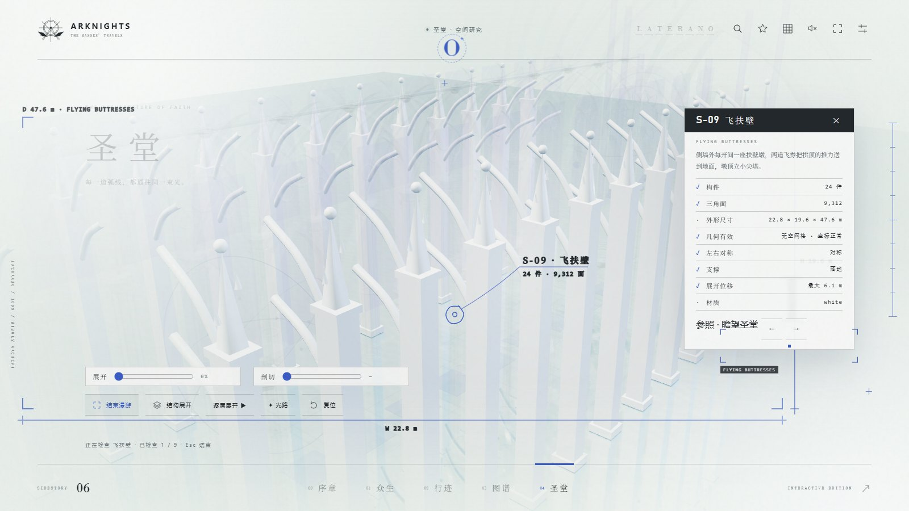</td>
<td width="50%">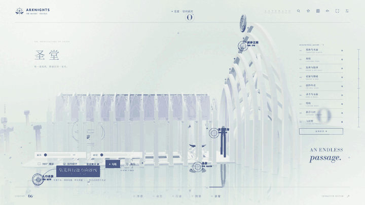</td>
</tr>
<tr>
<td align="center"><sub>检查「飞扶壁」：手绘裁切角、W/H/D 尺寸线与引线标签</sub></td>
<td align="center"><sub>「✦ 光路」：按光的方向点亮四个光点，一道光从门口射向面纱之眼</sub></td>
</tr>
</table>

九组结构，全部由代码一块块搭起来：

1. 基座与水面
2. 束柱
3. 连拱与肋拱
4. 花窗与玫瑰窗
5. 面纱尖塔
6. 圣手与圣盆
7. 残柱
8. 悬浮几何
9. 飞扶壁

可以整体展开、逐层展开、剖切。点击建筑或列表进入检查，报告会列出构件数、面数、尺寸、几何有效性、对称、支撑和展开位移；「逐项检查」会自动巡检一遍。

**光路**：依次点亮入口台阶 → 圣盆 → 玫瑰花窗 → 面纱之眼。点错了，光点会摇一摇头。

### 卡片与全局

- **卡片**：在行迹或众生中点「生成卡片」，本地合成 1600×900 PNG，有纸面 / 图纸 / 夜色三种版式，可以下载。
- **转场**：交叉淡入淡出，元素错落进场。
- **光标**：准星光标、点击留痕，字母随机变形翻转。
- **工具**：检索、收藏、图纸模式、活动 BGM、减少动态效果、全屏。

---

## 🔍 隐藏玩法

<details>
<summary><b>剧透警告：点开看全部可以触发的图形</b></summary>

| 在哪 | 怎么做 | 得到 |
| --- | --- | --- |
| 行迹 | 双击 MT-1、MT-TR-1、MT-2 | 「启程」三角 |
| 行迹 | 把四个干员节点连起来 | 「众生」四边形 |
| 行迹 | 双击 MT-5、MT-6、EX-1 | 「向光」折线 |
| 行迹 | 任意落点后绕回起点 | 闭合图形，标出面积 |
| 图谱 · 圣像 | 光环 + 两侧衣摆 | 「圣像」，羽翼自动展开 |
| 图谱 · 圣像 | 左球 + 光环 + 右球 | 「双环」 |
| 圣堂 | 打开「✦ 光路」，依次点 门 → 盆 → 玫瑰窗 → 眼 | 光束贯穿圣堂 |
| 全局 | 各页面藏着蓝色字母，集齐 **LATERANO** | 自动开启图纸模式 |

</details>

**深链**：下面这些地址可以直接打开对应页面或节点，地址栏也会随浏览同步。

- `#/sanctum/5`：检查第 5 组
- `#/sanctum/x`：展开
- `#/records/mt-5`
- `#/operators/graceb`
- `#/atlas/3`

**快捷键**：

| 键 | 作用 |
| --- | --- |
| `←` `→` | 切换干员 / 行迹节点 / 图谱 / 圣堂结构 |
| `/` | 检索 |
| `M` | 声音 |
| `B` | 图纸模式 |
| `F` | 全屏 |
| `Esc` | 关闭浮层、退出光路，或返回首页 |

---

## ✏️ 线条是怎么“画”出来的

所有手绘感都来自 [`src/sketch.ts`](src/sketch.ts)，它只用几个简单规则：

| 元素 | 做法 |
| --- | --- |
| 圆环 `ring` | 半径叠两层正弦起伏，收笔时**越过起点**一小段 |
| 标线 `rule` | 中段微微拱起，两端各冲出一点 |
| 笔刷 `brush` | 沿路径算法线，两端渐细成一个闭合轮廓 |
| 套印 `inked` | 同一条线偏移再描一遍，透明度更低 |
| 光刃 / 星芒 | `blade` / `sparkle`，用于图版边缘的碎片 |

每条线都由种子驱动（`rng(seed)`），所以每次刷新画面完全一致，也能写成测试。

**线宽跟着景深走**：图版里每一层都有一个景深值 `d`，渲染时自动按它缩放 `stroke-width`。

| 景深 `d` | 倍率 | 典型内容 |
| --- | --- | --- |
| < 0.3 | ×0.6 | 半调、远景大圆、放射线 |
| < 0.6 | ×0.85 | 构造圈、轨道 |
| < 1.0 | ×1.15 | 编号、星座、拼贴界面框 |
| ≥ 1.0 | ×1.55 | 职业图标、近景笔刷、鸽子 |

行迹和图谱用 CSS 分层做了同样的事：引导线最细，基线和节点六边形最粗。

**拼贴元素**在 [`src/collage.ts`](src/collage.ts)：界面框、信封、车票、鸽子、花、草枝、点阵、放射线、像素块和大圆。它们和图版共用同一套手绘线条。

---

## 🪪 个人网站样例

<table>
<tr>
<td width="50%">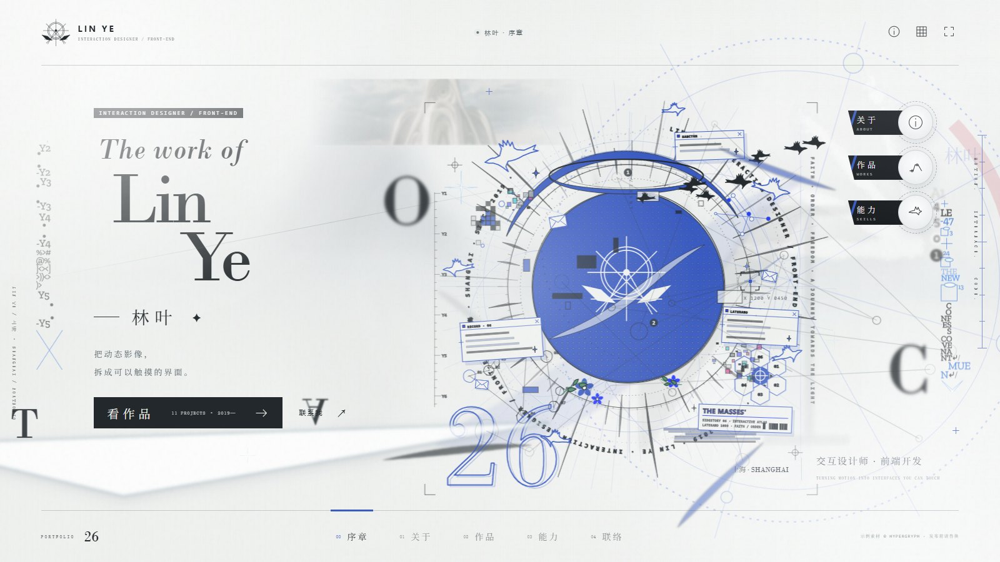</td>
<td width="50%">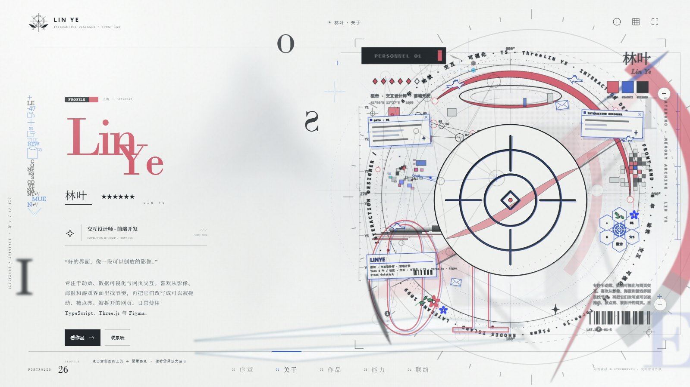</td>
</tr>
</table>

`personal.html`（离线版：双击 **`个人网站样例.html`**）用同一套模板做了一个作品集示例，身份是虚构的「林叶 · 交互设计师」：

| 页面 | 沿用的模板 | 内容 |
| --- | --- | --- |
| 序章 | 首页 | 姓名大字、主视觉图版（环形铭文为个人信息）、快速入口 |
| 关于 | 人员图版 | 姓名字母汇聚、简介、个人图版、圆弧 ＋ 节点显示要点 |
| 作品 | 行迹地图 | 每个作品一个节点（PROJECT / LAB / NOTE / NEXT），面板含标签与项目链接 |
| 能力 | 羽兽图谱 | 每只鸟携带一项能力，悬停读取、点击放飞，右侧列表可定位 |
| 联络 | 双手契约 | 指尖相触后展开联系卡片，可一键复制邮箱 |

**改成你自己的**：

1. 编辑 `src/site/profile.ts`：姓名、简介、要点、图版图标与星级、作品、能力、联系方式。
2. 运行 `npm run build` 重新生成。

主视觉和个人图版都是绘制的图形，不需要照片。作品预览默认用游戏关卡预览图占位，公开发布前请换成自己的截图。

---

## 🎬 演示视频与发布素材

- **本机视频**：`众生行记-演示-4K60.mp4`，3 分钟，3840×2160 / 60 fps，由网页逐帧录制。成片体积较大，未纳入 GitHub 仓库；下载源码后可按录制说明自行生成。
  - 录制时用虚拟时钟和脚本化指针动作，并等待合成器更新后再截取帧。
  - 用 WebCodecs 编码 H.264 / AAC，再用自写的 MP4 封装。
  - 提供闪烁与图层掉帧检测脚本供检查录制结果；脚本检测不等同于完整的 WCAG 合规验证。
- **重新录制**：步骤见 [`scripts/demo-video/README.md`](scripts/demo-video/README.md)。先出 960×540 预览，确认后再录 4K，4K 约需 1.5 至 2 小时。
- **发布素材**：在 `发布素材/` 里。
  - 简约封面：`封面-简约-*.png`，本页顶部那张就是；
  - 信息版封面：`封面-A/B-*.png`；
  - B 站标题、简介、时间轴与标签：`标题与简介.md`。

> 当前视频录制于拼贴元素加入之前；想让视频里也有鸽子和信封，按上面的步骤重新录一遍即可。

本 README 的截图由 `scripts/demo-video/readme-shots.mjs` 用真实指针操作网站后截取。动图截自演示视频。

---

## 🛠️ 本地服务与源码开发

已安装 Node.js 24 时，可以双击 `启动.cmd`：

- 终端显示网址后会尝试打开默认浏览器；没有自动打开的话，把终端里的 `http://127.0.0.1:端口/` 复制到浏览器。
- 默认端口 5173，被占用时自动找下一个。
- 保持终端开启；关闭终端即停止服务。

GitHub 仓库不包含 `dist/`。下载后可以直接打开离线 HTML；要用本地服务，先运行 `npm ci` 和 `npm run build`。

开发（也可双击 `开发启动.cmd`）：

```powershell
npm ci
npm run dev
```

构建网页与离线 HTML，再跑测试和资源校验：

```powershell
npm run build
npm test
npm run verify
```

- `npm run build:offline` 只重新生成离线 HTML。
- 正式本地服务使用 `dist/`，改完源码需要重新构建并刷新浏览器。

---

## 📦 本机游戏素材

`public/assets/game/` 里的 70 件素材由 `scripts/extract-game-assets.py` 从本机《明日方舟》PC 客户端提取：

- 活动复刻包 `permanent_sidestory_32_the_masses_travels.ab`：地图长卷、图集碎片、入口徽章；
- 关卡预览；
- 活动系统 BGM，截取前 96 秒。

脚本不提取角色立绘，图集里属于立绘的裁片（眼部、发丝、侧像）也已跳过。客户端资源包使用改动过的 LZ4 块格式，脚本内置了解压。

`hand-silhouette.webp` 是从手部贴图派生的纯色剪影，供首页钴蓝手使用。

来源、裁切坐标与 SHA-256 记录在 `public/assets/game/game-assets.json`，`npm run verify` 会逐个校验。

```powershell
pip install UnityPy lameenc pillow
python scripts/extract-game-assets.py "F:/Hypergryph Launcher/games/Arknights"
```

## 🗃️ 已移除的内容

2026-10-12 起移除了映像部分（120 秒影片演出、原片对照、PV 音轨与静帧）和全部干员立绘。

相关源码与素材保留在本机项目根目录的 `_removed/`，不参与构建、打包或 GitHub 同步。本机清单见 `_removed/REMOVED-ASSETS.json`。

## 📁 文件结构

```text
双击打开.html              无依赖离线入口
个人网站样例.html          个人网站样例的离线入口
启动.cmd / 开发启动.cmd   Windows 启动器（ASCII / CRLF）
dist/                    已构建的网页和本地素材
src/main.ts              页面、状态与交互
src/plates.ts            绘制的图版：人员图版、主视觉图版、行迹记录图版、职业图标；按景深定线宽
src/sketch.ts            手绘线条：起伏圆环、越界标线、渐细笔刷、光刃、星芒、错位描线
src/collage.ts           拼贴元素：界面框、信封、车票、鸽子、花枝、点阵、像素块
src/sigil.ts             连点闭合后的图形效果（填色、射线、笔刷边、面积）
src/ui.ts                共享图标、印记、圆环与圆弧
src/site/                个人网站样例（profile.ts 为全部可编辑内容）
src/scene.ts             Three.js 场景：展开、检查、剖切、拾取、相机、光束
src/sanctum.ts           圣堂建模（九组结构、各构件的展开方向、光路关键点）
src/overlay.ts           圣堂上的手绘检查标注与光路谜题
src/graphics.ts          SVG 图形：编号鸟群、光环人像、点阵人形、六边形节点
src/fx.ts                准星光标、文字解码、转场、节点连线
src/route.ts             行迹地图（五层视差、靠近显现、速度模糊、测绘、连点图形）
src/sequence.ts          行迹背后随拖动进度演出的序列
src/atlas.ts             图谱交互（风场、放飞/框选/召回、构造圆、隐藏点位、契约）
src/covenant.ts          双手契约：游戏手部贴图、构造线、距离变色、相触事件
src/data.ts              干员、记录、行迹节点与散落字母
src/storage.ts           收藏与设置的本地存储
src/util.ts              数值工具
src/style.css            基础布局与响应式样式
src/graphic.css          平面设计层：图纸、节点、图版、拼贴、分层线宽、转场
src/assets.ts            普通/离线素材地址切换
public/assets/game/      本机游戏客户端提取的地图、碎片与 BGM
scripts/                 本地服务、离线打包、资源校验、素材提取
scripts/demo-video/      4K60 演示视频录制、封面生成、README 截图
tests/                   数据、图版、手绘线条与圣堂结构测试
docs/images/             本 README 的截图与动图
发布素材/                 视频封面、标题与简介
_removed/                已移除的映像与立绘（源码与素材，不参与构建）
VALIDATION.md            实际验证结果与未验证范围
THIRD_PARTY_NOTICES.txt   第三方组件及素材说明
```

## 📚 来源

- 视觉参考：[《明日方舟》六周年庆典活动宣传 PV](https://www.bilibili.com/video/BV15HLdz6E99/)
- 活动界面参考：[「众生行记」UI / 交互 / 动效记录](https://www.bilibili.com/video/BV1WFkwBJEhR/)
- 插图画风参考：[一分钟教会你众生行记风格的插图](https://www.bilibili.com/video/BV1qfGAzXExX/)
- 交互改编思路参考：[LBEILC / RhineLabUI](https://github.com/LBEILC/RhineLabUI)
- 地图、碎片、BGM：本机游戏客户端，见 `public/assets/game/game-assets.json`。

---

<sub>非官方本地学习作品。《明日方舟》名称、角色、美术、视频和音乐归鹰角网络及相应权利人所有。代码中的图版、三维建筑、几何标志和界面是本项目的绘制与重建。`public/assets/game/` 中的贴图与音乐提取自本机游戏客户端，仅供本地学习，请勿再分发；不包含任何三维模型。网页运行时不读取游戏安装、账号或存档，提取只在运行脚本时进行。README 截图中出现的游戏地图与碎片同样仅作说明之用。</sub>
